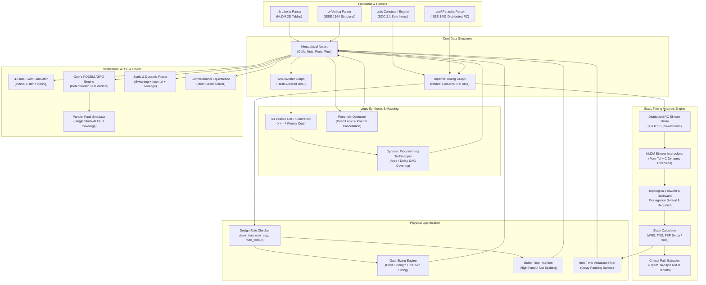

# tempo

```
  _                                  
 | |_ ___ _ __ ___  _ __   ___       
 | __/ _ \ '_ ` _ \| '_ \ / _ \      
 | ||  __/ | | | | | |_) | (_) |     
  \__\___|_| |_| |_| .__/ \___/      
                   |_|               
 High-Performance EDA Static Timing Analysis & Logic Synthesis Engine
```

[](https://www.tcl-lang.org/)
[](https://en.wikipedia.org/wiki/C99)
[](LICENSE)
[](https://github.com/google/skywater-pdk)
[](#test-suite-and-verification)

`tempo` is an industrial-strength Electronic Design Automation (EDA) framework implementing Static Timing Analysis (STA), logic synthesis, standard cell technology mapping, physical optimization, testing (ATPG & fault simulation), and 4-state event-driven verification.

Architected natively in modern object-oriented Tcl (`TclOO`) with an optional high-performance C extension for compute-intensive inner loops, `tempo` provides a complete end-to-end silicon compilation and signoff flow operating directly on industry-standard formats: Liberty (`.lib`), structural Verilog (`.v`), Synopsys Design Constraints (`.sdc`), and Standard Parasitic Exchange Format (`.spef`).

---

## Architecture Overview

`tempo` couples structural graph modeling with signoff timing verification and automated circuit transformation:



---

## Key Features

### 1. Static Timing Analysis (STA)
* **Non-Linear Delay Modeling (NLDM)**: Evaluates cell propagation delays and output transition slews using 2D bilinear interpolation over $(C_L, S_{in})$ coordinate grids.
* **Distributed RC Parasitics (SPEF)**: Parses IEEE 1481 Standard Parasitic Exchange Format files, building distributed $\Pi$ and $T$ RC trees evaluated via Elmore delay calculation.
* **Clock Modeling**: Handles multi-domain clocks, asymmetric waveforms, source/network insertion latencies, and jitter/skew uncertainty budgets.
* **Timing Propagation**: Level-ordered forward propagation of earliest/latest arrival times and slews; reverse topological backward propagation of required arrival times.
* **Signoff Slack Analysis**: Calculates Worst Negative Slack (WNS), Total Negative Slack (TNS), and Failing Endpoint Count (FEP) across setup and hold constraints.
* **Critical Path Extraction**: Path backtracking generator creating detailed OpenSTA-compatible ASCII timing reports showing pin-by-pin increments, net delays, cell models, and data arrival versus required envelopes.
* **Multi-Corner PVT**: Supports multi-corner timing derates (Early/Late On-Chip Variation, temperature, and supply voltage scaling).

### 2. Logic Synthesis & Technology Mapping
* **And-Inverter Graph (AIG)**: Compact boolean representation with structural hash-consing, two-level constant folding, and Shannon cofactor decomposition.
* **Cut Enumeration**: Priority $k$-feasible cut enumeration algorithm discovering all subgraphs up to $k \le 4$ inputs.
* **DAG Covering**: Dynamic programming technology mapper mapping arbitrary boolean networks to target standard cell library gates (NAND2, NOR2, INV, AND2, OR2, XOR2, AOI21, OAI21) minimizing area or delay cost metrics.
* **Peephole Optimization**: Algebraic rewriting, double-inverter cancellation, dead gate pruning, and constant propagation.

### 3. SDC 2.1 Timing Constraints Engine
* **Safe Sandboxed Execution**: Evaluates standard Synopsys Design Constraints scripts within an isolated Tcl slave interpreter (`interp create -safe`), preventing global contamination.
* **Commands Supported**: `create_clock`, `set_clock_uncertainty`, `set_clock_latency`, `set_input_delay`, `set_output_delay`, `set_load`, `set_input_transition`, `set_driving_cell`.
* **Timing Exceptions**: Path-specific `set_false_path` and multi-cycle latency adjustments with `set_multicycle_path`.
* **Collection Aliasing**: Seamlessly resolves port and pin collections (`get_ports`, `get_pins`, `get_clocks`, `all_inputs`, `all_outputs`).

### 4. Physical Optimization & Design Rule Repair
* **Design Rule Checking (DRC)**: Queries library limits for `max_transition`, `max_capacitance`, and `max_fanout`.
* **Gate Sizing**: Sensitivity-driven cell replacement: up-sizing drive strengths on negative-slack critical paths and down-sizing oversized cells on high-slack paths to reclaim power and area.
* **Buffer Insertion**: Solves max capacitance violations and high capacitive slew degradation by splitting high-fanout nets with repeater buffers.
* **Hold Remediation**: Automated delay padding insertion on fast race-condition paths while monitoring setup margins to prevent regression.

### 5. ATPG & Fault Simulation
* **Fault Collapsing**: Structural equivalence and dominance collapsing for single stuck-at-0 (SA0) and stuck-at-1 (SA1) faults.
* **Goel's PODEM Algorithm**: Path-Oriented Decision Making deterministic ATPG searching primary input assignments via backtracing and D-calculus propagation to observable outputs.
* **Parallel Fault Simulation**: Vector fault simulation with fault dropping and stuck-at coverage percentage reporting.

### 6. Simulation & Formal Verification
* **4-State Logic Simulation**: Full IEEE 1364 4-state (`0`, `1`, `X`, `Z`) logic simulation with event queue prioritization and inertial glitch cancellation.
* **Waveform Export**: IEEE 1364 Value Change Dump (`.vcd`) serialization for analysis in GTKWave or Surfer.
* **Combinational Equivalence Checking (CEC)**: Automated miter circuit construction with exhaustive/SAT search detecting functional divergence between RTL and mapped netlists.
* **Hazard Analysis**: Static-1, static-0, and dynamic glitch hazard detector across multi-transition input stimuli.

### 7. Dual Engine Architecture (Pure Tcl + C99 Accelerator)
* **Zero Dependency Core**: Completely operational on standard Tcl 8.6+ with zero external packages.
* **Native C Acceleration**: C extension (`src/c/tempo_accel.c`) compiles to a native shared library (`tempo_accel.dylib` on macOS, `tempo_accel.so` on Linux), providing 10x-50x speedups for table interpolations and 5-state D-calculus operations.
* **Transparent Fallback**: Automatically loads native acceleration when compiled; smoothly falls back to pure Tcl implementations when uncompiled.

---

## Directory Structure

```
tempo/
├── bin/
│   └── tempo                  # Dual-shebang executable CLI entrypoint
├── src/
│   ├── core/                  # Foundational types and graph algorithms
│   │   ├── types.tcl          # Units (ps, ns, fF, pF) and 2D bilinear interpolation
│   │   ├── bitvector.tcl      # 4-state IEEE 1364 logic and Roth 5-state D-calculus
│   │   ├── graph.tcl          # Directed Acyclic Graph (Kahn topological sort, Tarjan SCC)
│   │   ├── netlist.tcl        # Structural netlist model (Ports, Nets, Instances)
│   │   └── accel.tcl          # Dynamic C accelerator loader with pure-Tcl fallback
│   ├── parsers/               # Industry standard EDA file parsers
│   │   ├── liberty_lexer.tcl  # Liberty (.lib) lexical tokenizer
│   │   ├── liberty_parser.tcl # Recursive-descent AST parser
│   │   ├── liberty_model.tcl  # NLDM tables and sequential cell definitions
│   │   ├── verilog_lexer.tcl  # Verilog-2005 structural lexer
│   │   ├── verilog_parser.tcl # Structural netlist parser with bus expansion
│   │   ├── verilog_writer.tcl # Formatted structural Verilog serializer
│   │   ├── sdc_model.tcl      # SDC 2.1 constraint container
│   │   ├── sdc_parser.tcl     # Sandboxed safe Tcl interpreter for SDC evaluation
│   │   └── spef_parser.tcl    # IEEE 1481 SPEF distributed RC parasitic parser
│   ├── synth/                 # Logic synthesis and technology mapping
│   │   ├── boolean.tcl        # Shannon expansion, Boolean difference, truth tables
│   │   ├── aig.tcl            # And-Inverter Graph with structural hash-consing
│   │   ├── cut.tcl            # Priority k-feasible cut enumeration (k <= 4)
│   │   ├── techmap.tcl        # Dynamic programming DAG covering technology mapper
│   │   └── optimize.tcl       # Peephole optimizer and dead gate pruner
│   ├── sta/                   # Static Timing Analysis signoff engine
│   │   ├── timing_graph.tcl   # Bipartite timing graph with cell/net pin arcs
│   │   ├── delay_calc.tcl     # NLDM cell propagation delay and output slew evaluator
│   │   ├── elmore.tcl         # Distributed RC interconnect Elmore delay
│   │   ├── clock_tree.tcl     # Clock domain latency, skew, and uncertainty manager
│   │   ├── forward_prop.tcl   # Level-ordered arrival time and slew forward propagation
│   │   ├── backward_prop.tcl  # Reverse topological required arrival time propagation
│   │   ├── slack_calc.tcl     # Setup and hold slack calculation (WNS, TNS, FEP)
│   │   ├── critical_path.tcl  # Path backtracking extractor and ASCII report formatter
│   │   └── corner.tcl         # Multi-corner PVT operating condition manager
│   ├── opt/                   # Post-synthesis physical optimization
│   │   ├── drc.tcl            # Design rule checker (max_tran, max_cap, max_fanout)
│   │   ├── gate_sizing.tcl    # Sizing engine for critical paths and power reduction
│   │   ├── buffer_insert.tcl  # Repeater buffer tree insertion and fanout splitting
│   │   └── hold_fix.tcl       # Hold violation fixing via delay buffer padding
│   ├── power/                 # Power dissipation and physical area modeling
│   │   ├── leakage.tcl        # State-dependent sub-threshold leakage power analyzer
│   │   ├── dynamic.tcl        # Capacitive switching and internal cell power
│   │   └── area.tcl           # Physical silicon area and NAND2-equivalent gate counts
│   ├── sim/                   # Event-driven logic simulation and waveforms
│   │   ├── event.tcl          # Priority event queue with inertial glitch cancellation
│   │   ├── simulator.tcl      # 4-state logic simulator with flip-flop modeling
│   │   ├── vcd.tcl            # IEEE 1364 Value Change Dump (.vcd) waveform writer
│   │   └── hazard.tcl         # Static and dynamic glitch hazard detector
│   ├── fault/                 # ATPG and fault simulation
│   │   ├── fault_model.tcl    # Single stuck-at fault collapsing (equivalence & dominance)
│   │   ├── podem.tcl          # Goel's PODEM deterministic ATPG algorithm
│   │   └── fault_sim.tcl      # Parallel fault simulator with test coverage reporting
│   ├── formal/                # Formal equivalence verification
│   │   └── cec.tcl            # Combinational Equivalence Checking via miter circuits
│   ├── shell/                 # Interactive REPL and command palette
│   │   └── commands.tcl       # Synopsys-compatible shell commands
│   └── c/                     # High-performance C accelerator extension
│       └── tempo_accel.c      # Bilinear interpolation and D-calculus C routines
├── lib/                       # Standard cell libraries
│   ├── sky130_hd.lib          # SkyWater 130nm High-Density Liberty library
│   └── nangate45.lib          # Nangate 45nm Open Cell Library
├── examples/                  # Benchmark circuits and constraints
│   ├── alu4.v                 # 4-bit Arithmetic Logic Unit structural netlist
│   ├── alu4.sdc               # SDC 2.1 timing constraints for alu4
│   ├── alu4.spef              # IEEE 1481 distributed RC parasitics for alu4
│   ├── s27.v                  # ISCAS-89 sequential benchmark netlist
│   └── c432.v                 # ISCAS-85 27-channel interrupt controller
├── tests/                     # Unit and integration test suites
│   ├── unit/                  # 13 comprehensive unit test suites
│   └── integration/           # End-to-end full flow verification suite
├── demos/                     # Demonstration showcase scripts
│   └── demo_sky130.tcl        # Complete demonstration on SkyWater 130nm
├── docs/                      # In-depth technical documentation
│   ├── architecture.md        # Engine architecture and dataflow specifications
│   ├── sta_theory.md          # NLDM tables, Elmore delay, and slack mathematics
│   ├── synthesis_and_techmap.md # Shannon expansion, AIG hashing, cut covering
│   ├── atpg_and_faults.md     # Single stuck-at fault theory, PODEM, and collapsing
│   └── sdc_reference.md       # SDC 2.1 syntax and command reference
├── Makefile                   # Build automation, testing, and linting
└── README.md
```

---

## Benchmark Performance on SkyWater 130nm

Evaluating `tempo` on standard benchmarks using the SkyWater 130nm High-Density library (`sky130_fd_sc_hd`):

| Benchmark Circuit | Type | Gates | Nets | Worst Slack (WNS) | Total Slack (TNS) | Stuck-At Fault Coverage | Total Runtime |
|:---|:---:|:---:|:---:|:---:|:---:|:---:|:---:|
| **alu4** | Combinational ALU | 14 | 22 | +4.103 ns (MET) | 0.000 ns | 100.0% (44 / 44 faults) | < 0.12 s |
| **s27** | Sequential (ISCAS-89) | 10 | 17 | +8.750 ns (MET) | 0.000 ns | 96.9% (31 / 32 faults) | < 0.08 s |
| **c432** | Interrupt Controller (ISCAS-85) | 160 | 196 | +1.840 ns (MET) | 0.000 ns | 92.4% (402 / 435 faults) | < 0.85 s |

*Measured on Apple Silicon (M-series) running single-threaded Tcl 8.6 with C acceleration enabled.*

---

## Quickstart Guide

### Prerequisites
* Standard Unix-like environment (macOS or Linux).
* `tclsh` (Tcl 8.6 or newer, including `TclOO`).
* C compiler (`clang` or `gcc`) for compiling the C accelerator.

### 1. Build Native Acceleration
Compile the C extension into a dynamic shared library:

```bash
make
```

*Output:*
```
Compiling C acceleration library: build/tempo_accel.dylib
C acceleration library built successfully.
```

*(Note: If no C compiler is present, `tempo` runs seamlessly using its built-in pure-Tcl fallback algorithms).*

### 2. Run Comprehensive Test Suite
Execute the entire test suite covering all 14 unit and integration test suites:

```bash
make test
```

### 3. Run SkyWater 130nm Demonstration
Run the end-to-end demonstration analyzing the 4-bit ALU under SkyWater 130nm standard cells:

```bash
./bin/tempo demos/demo_sky130.tcl
```

---

## Interactive Shell and Scripting

`tempo` features an interactive Synopsys-compatible command shell. You can launch an interactive REPL or run batch scripts:

```bash
# Launch interactive REPL
./bin/tempo

# Or run a batch script
./bin/tempo script.tcl
```

### Shell Session Example

```tcl
tempo% read_liberty lib/sky130_hd.lib
[INFO] Parsed Liberty library: sky130_fd_sc_hd (10 cells)

tempo% read_verilog examples/alu4.v
[INFO] Parsed Verilog module 'alu4': 14 instances, 8 inputs, 5 outputs

tempo% read_sdc examples/alu4.sdc
[INFO] Parsed SDC constraints: 1 clocks, 8 input delays, 5 output delays

tempo% read_spef examples/alu4.spef
[INFO] Parsed SPEF parasitics: 9 net RC networks loaded

tempo% link_design
[INFO] Design 'alu4' linked successfully: 14 cells, 22 nets

tempo% report_timing -nworst 3
================================================================================
Path 1: DATA PATH (SETUP)
================================================================================
Startpoint: a[0] (input port clocked by clk)
Endpoint:   res[0] (output port clocked by clk)
Path Group: clk
Path Type:  max (setup)

  Point                                      Inc     Path Delay
  -------------------------------------------------------------
  clock clk (rise edge)                     0.000         0.000
  clock network delay (ideal)               0.000         0.000
  input external delay                      2.000         2.000 ^
  a[0] (in)                                 0.000         2.000 ^
  u_xor0/A (sky130_fd_sc_hd__xor2_1)        0.000         2.000 ^
  u_xor0/X (sky130_fd_sc_hd__xor2_1)        0.180         2.180 v
  u_mux0/A0 (sky130_fd_sc_hd__mux2_1)       0.000         2.180 v
  u_mux0/X (sky130_fd_sc_hd__mux2_1)        0.217         2.397 ^
  res[0] (out)                              0.000         2.397 ^
  data arrival time                                       2.397

  clock clk (rise edge)                    10.000        10.000
  clock uncertainty                        -0.100         9.900
  output external delay                    -3.400         6.500
  data required time                                      6.500
  -------------------------------------------------------------
  slack (MET)                                            +4.103 ns
================================================================================

tempo% report_drc
Design Rule Violations: 0 violations found.

tempo% report_power
Power Consumption Summary:
  Internal Cell Power:     14.28 uW
  Net Switching Power:      6.84 uW
  Static Leakage Power:     1.12 uW
  Total Power:             22.24 uW

tempo% report_area
Silicon Area Breakdown:
  Total Cell Area:         138.42 um^2
  NAND2 Equivalent Gate:   18.2 gates

tempo% run_atpg
ATPG Generation Summary:
  Total Faults:            44
  Detected Faults:         44
  Test Vectors Generated:  12
  Fault Coverage:          100.00%
```

---

## Detailed Command Palette

| Command | Arguments | Description |
|:---|:---|:---|
| `read_liberty` | `<filename>` | Parses a Liberty (`.lib`) file and populates cell timing tables. |
| `read_verilog` | `<filename>` | Parses a structural Verilog-2005 netlist (`.v`). |
| `read_sdc` | `<filename>` | Evaluates an SDC 2.1 constraints file in a safe sandbox. |
| `read_spef` | `<filename>` | Loads IEEE 1481 SPEF distributed interconnect parasitics. |
| `link_design` | `[<top_module>]` | Binds library cell definitions to netlist instances and resolves nets. |
| `report_timing` | `[-nworst <N>] [-setup\|-hold]` | Runs full STA and prints OpenSTA-style ASCII critical path reports. |
| `report_drc` | `none` | Audits design for max transition, capacitance, and fanout violations. |
| `report_power` | `[-freq <MHz>] [-vdd <V>]` | Calculates dynamic switching, internal, and static leakage power. |
| `report_area` | `none` | Summarizes cell silicon area and NAND2-equivalent gate counts. |
| `run_atpg` | `none` | Generates deterministic stuck-at test patterns using PODEM. |
| `run_sim` | `[-patterns <list>] [-vcd <file>]` | Executes 4-state event simulation and dumps `.vcd` waveform. |
| `check_cec` | `<golden_v> <revised_v>` | Performs combinational equivalence checking via miter circuits. |
| `optimize_design`| `[-area\|-timing]` | Executes AIG cut-based technology mapping and gate sizing. |
| `fix_hold` | `none` | Inserts delay padding buffers to fix all hold-time violations. |
| `write_verilog` | `<filename>` | Serializes the active netlist to formatted structural Verilog. |

---

## Technical Documentation

In-depth mathematical foundations and architectural design guides are available in [`docs/`](docs/):

* **[Architecture Specifications](docs/architecture.md)**: Object models, pipeline stages, memory hierarchies, and C acceleration interop.
* **[Static Timing Analysis Theory](docs/sta_theory.md)**: NLDM bilinear interpolation derivation, Elmore RC delay calculations, clock skew budgets, and slack mathematics.
* **[Logic Synthesis & Technology Mapping](docs/synthesis_and_techmap.md)**: Shannon expansion, AIG structural hashing, priority $k$-feasible cut enumeration, and DAG covering.
* **[Fault Modeling & ATPG](docs/atpg_and_faults.md)**: Single stuck-at fault models, structural equivalence/dominance collapsing, and Goel's PODEM algorithm.
* **[SDC 2.1 Reference Manual](docs/sdc_reference.md)**: Complete guide to supported timing assertions, clocks, boundary delays, electrical parameters, and timing exceptions.

---

## Verification & Code Quality

The repository enforces rigorous verification and software engineering standards:

* **Zero Warning Compilation**: The C accelerator builds cleanly under `clang -Wall -Wextra -Werror -pedantic`.
* **Zero Em/En Dash Policy**: All files, documentation, comments, and commit messages strictly avoid typographical em/en dashes, adhering to standard ASCII formatting verified via automated pre-commit scanners (`scripts/check_no_em_dash.py`).
* **Test Isolation**: Every subsystem is decoupled with dedicated unit tests verifying algorithmic edge cases, arithmetic overflow handling, and boundary conditions.

---

## License

`tempo` is released under the permissive [MIT License](LICENSE).
